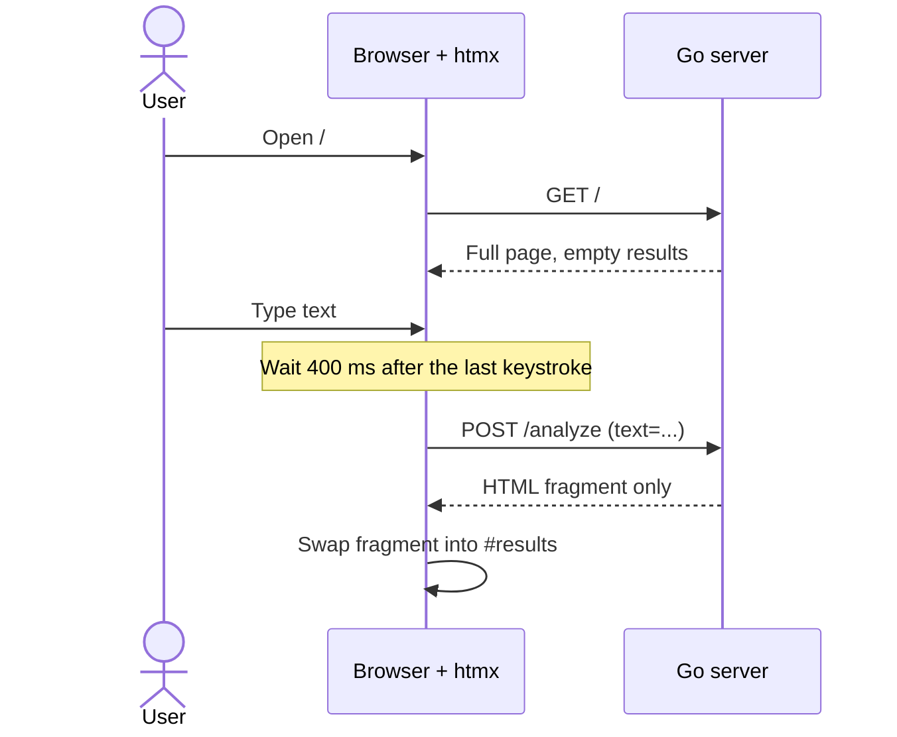
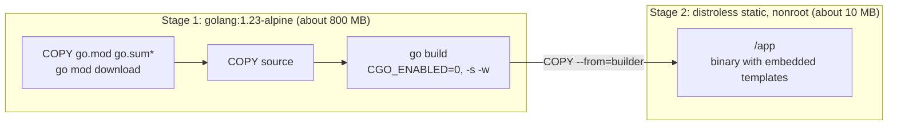
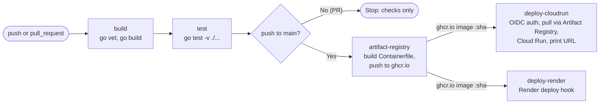

# go-htmx-hackday

Companion repo for **Workshop 1: CI/CD with GitHub Actions, Docker & Automated Deployment**.
Hacktoberfest Hack Day Buea 2026 · Norbel Ambanumben

A Go 1.23 + HTMX text analyzer. It ships as a ~10 MB distroless image to ghcr.io, and every push to `main` deploys it to Google Cloud Run and Render.

## Live demo

| Platform | URL |
|----------|-----|
| Google Cloud Run | https://go-htmx-hackday-762003939747.europe-west1.run.app |
| Render | https://go-htmx-hackday-26.onrender.com |

Both run the same image from the same commit. The page footer shows the commit's short SHA, and the header badge shows which platform served the page.

## Slide to file map

| Slide | File |
|-------|------|
| Step 1a/1b: Go + HTMX server, `$PORT`, `/healthz`, `//go:embed` | [`main.go`](main.go), [`templates/`](templates) |
| Step 2a/2b: Multi-stage Containerfile | [`Containerfile`](Containerfile) |
| Step 3a/3b: GitHub Actions CI + ghcr.io | [`.github/workflows/deploy.yml`](.github/workflows/deploy.yml): jobs `build`, `test`, `artifact-registry` |
| Step 4a/4b: Keyless OIDC deploy to Cloud Run | same workflow: job `deploy-cloudrun` |

How a request works:



Endpoints:

- `GET /`: HTMX page
- `POST /analyze`: returns the HTML fragment for `#results`
- `GET /healthz`: returns `200 ok`

## Run locally

```sh
make run          # go run . on :8080
make test         # go vet + go test
make image        # podman build -f Containerfile -t go-htmx .
make image-run    # podman run -p 8080:8080 go-htmx
```

To use Docker instead of Podman, run `make image ENGINE=docker`, or run `docker build -f Containerfile .` directly.

## Styling

The page uses Tailwind CSS v4 through the browser build (`@tailwindcss/browser@4.3.3`), pinned with an SRI hash. No Node or npm is needed, and HTMX fragments are styled as soon as they are swapped in. Dark mode follows the OS setting.

Tailwind calls the browser build a development tool. For a production app, compile the CSS with the Tailwind standalone CLI in the builder stage and embed the output file.

## Container image



## Two differences from the slides

1. **`COPY go.mod go.sum* ./`.** This app uses only the standard library, so it has no `go.sum`. A plain `COPY go.mod go.sum ./` fails. The glob still works after you add dependencies.
2. **Cloud Run cannot pull from `ghcr.io`.** Cloud Run pulls only from Artifact Registry, `gcr.io`, and Docker Hub. CI still pushes to ghcr.io. Cloud Run pulls the same image through an **Artifact Registry remote repository** that proxies ghcr.io:
   `europe-west1-docker.pkg.dev/<PROJECT_ID>/ghcr/<owner>/<repo>:<sha>`

## Deploy to Cloud Run

Before the first deploy, set up Google Cloud and GitHub once by following [docs/cloud-run-setup.md](docs/cloud-run-setup.md). The guide covers:

- the Artifact Registry proxy for ghcr.io
- the deployer and runtime service accounts
- keyless Workload Identity Federation
- GitHub secrets and the first-run package visibility step
- runtime secrets such as `GEMINI_API_KEY`
- troubleshooting and cleanup

## Deploy to Render (optional)

The same image can also go to [Render](https://render.com). The `deploy-render` job calls a Render deploy hook with the ghcr.io image tagged with the commit SHA. If the `RENDER_DEPLOY_HOOK_URL` secret is not set, the job skips. Setup takes about 5 minutes: see [docs/render-setup.md](docs/render-setup.md).

## Pipeline

The workflow has five jobs. Each job starts only after the job before it succeeds. `deploy-cloudrun` and `deploy-render` both run after `artifact-registry`.

`artifact-registry` publishes to ghcr.io and contains no cloud-provider steps. Each deploy job handles its own platform, so a broken Cloud Run setup never blocks Render, and Render never blocks Cloud Run.



| Job | Runs on | What it does |
|-----|---------|--------------|
| `build` | push + PR | `go vet`, then `go build` |
| `test` | push + PR | `go test -v ./...` |
| `artifact-registry` | push to `main` | Builds the `Containerfile` and pushes it to ghcr.io (`:sha` and `:latest`). Outputs the image name. No cloud-provider steps. |
| `deploy-cloudrun` | push to `main` | Signs in to Google Cloud with OIDC. Pulls the image through the Artifact Registry proxy, which caches it. Deploys to Cloud Run and prints the `*.a.run.app` URL. |
| `deploy-render` | push to `main` | Calls the Render deploy hook with `ghcr.io/<repo>:<sha>`. Runs alongside `deploy-cloudrun`, and skips if `RENDER_DEPLOY_HOOK_URL` is not set. |

Each job asks only for the permissions it needs. Only `artifact-registry` gets `packages: write`. Only `deploy-cloudrun` gets `id-token: write`.

The image name passes from `artifact-registry` to both deploy jobs as a job output. If the ghcr package is still private, the proxy pull in `deploy-cloudrun` fails before Cloud Run is called.

## License

This project is licensed under the [MIT License](LICENSE).
