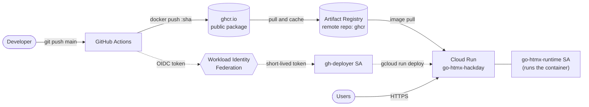
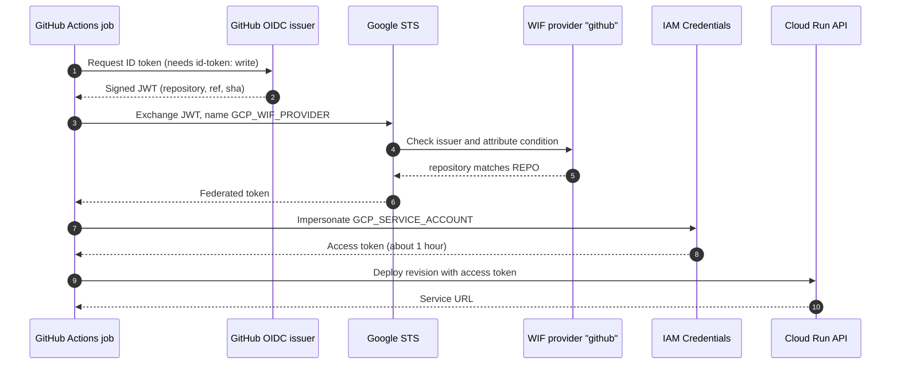
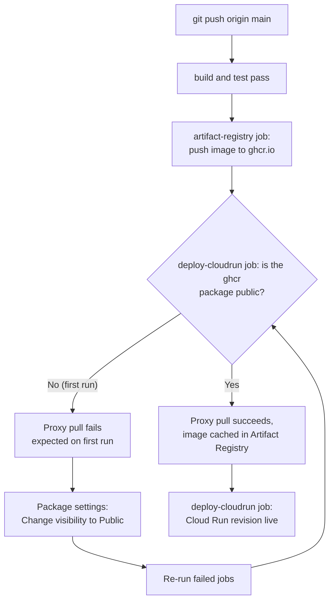

# Cloud Run setup

This guide prepares Google Cloud and GitHub so that every push to `main` deploys the app to Cloud Run. You do it once per project. It takes about 15 minutes.

When you finish, the pipeline works like this. Solid arrows carry the image. Dotted arrows carry credentials.



No JSON key is created or stored at any step.

## Contents

1. [Prerequisites](#1-prerequisites)
2. [Set shell variables](#2-set-shell-variables)
3. [Enable APIs](#3-enable-apis)
4. [Create the Artifact Registry remote repository](#4-create-the-artifact-registry-remote-repository)
5. [Create service accounts](#5-create-service-accounts)
6. [Set up Workload Identity Federation](#6-set-up-workload-identity-federation)
7. [Configure GitHub](#7-configure-github)
8. [First deploy](#8-first-deploy)
9. [Verify](#9-verify)
10. [Runtime secrets (optional)](#10-runtime-secrets-optional)
11. [Troubleshooting](#11-troubleshooting)
12. [Clean up](#12-clean-up)

## 1. Prerequisites

- A Google Cloud project with **billing enabled**. Cloud Run has a free tier, and a hackathon demo normally stays inside it. Billing must still be on.
- The [`gcloud` CLI](https://cloud.google.com/sdk/docs/install), signed in with `gcloud auth login`. Your user needs the **Owner** role on the project, or enough admin roles to create service accounts, IAM bindings and repositories.
- This repository pushed to GitHub. You need admin access to its settings.
- The [GitHub CLI](https://cli.github.com) (`gh`), signed in with `gh auth login`. Step 2 uses it to read the repository name. Without it, set `GITHUB_REPOSITORY=<owner>/<repo>` by hand.

You can also run every command in [Cloud Shell](https://shell.cloud.google.com), where `gcloud` is already installed and signed in.

## 2. Set shell variables

Every later command uses these variables. Run all steps in the same terminal session.

```sh
export PROJECT_ID=go-htmx-hackday     # REPLACE with your Google Cloud project ID
# owner/repo of your GitHub repository, exactly as GitHub shows it. Same name and value
# as the GITHUB_REPOSITORY variable inside GitHub Actions. Run this from your clone:
export GITHUB_REPOSITORY=$(gh repo view --json nameWithOwner -q .nameWithOwner)
export REGION=europe-west1                # must match REGION in deploy.yml
export SERVICE=go-htmx-hackday            # must match SERVICE in deploy.yml

export REPO_LC=$(echo "$GITHUB_REPOSITORY" | tr '[:upper:]' '[:lower:]')
export PROJECT_NUMBER=$(gcloud projects describe "$PROJECT_ID" --format='value(projectNumber)')
export DEPLOYER_SA=gh-deployer@$PROJECT_ID.iam.gserviceaccount.com
export RUNTIME_SA=go-htmx-runtime@$PROJECT_ID.iam.gserviceaccount.com

gcloud config set project "$PROJECT_ID"
```

If you change `REGION` or `SERVICE`, also change the `env:` block of the `deploy-cloudrun` job in [`.github/workflows/deploy.yml`](../.github/workflows/deploy.yml).

## 3. Enable APIs

```sh
gcloud services enable \
  run.googleapis.com \
  artifactregistry.googleapis.com \
  iam.googleapis.com \
  iamcredentials.googleapis.com \
  sts.googleapis.com
```

| API | Why |
|-----|-----|
| `run` | Cloud Run itself |
| `artifactregistry` | The ghcr.io proxy repository |
| `iam`, `iamcredentials`, `sts` | Workload Identity Federation and short-lived tokens |

## 4. Create the Artifact Registry remote repository

Cloud Run cannot pull images from `ghcr.io`. It pulls only from Artifact Registry, `gcr.io` and Docker Hub. A **remote repository** solves this. It proxies ghcr.io: the first pull of an image fetches it from ghcr.io and caches it in Artifact Registry.

```sh
gcloud artifacts repositories create ghcr \
  --repository-format=docker \
  --location="$REGION" \
  --mode=remote-repository \
  --remote-docker-repo=https://ghcr.io \
  --description="Proxy for ghcr.io"
```

Images are then available at this address:

```
$REGION-docker.pkg.dev/$PROJECT_ID/ghcr/$REPO_LC:<tag>
```

The workflow builds this address in the `deploy-cloudrun` job. The repository name `ghcr` is fixed in `deploy.yml`. If you choose another name, change it in the workflow too.

The proxy pulls from ghcr.io without credentials, so the ghcr package must be **public**. See [step 8](#8-first-deploy).

## 5. Create service accounts

The setup uses two service accounts:

- **Deployer** (`gh-deployer`): the identity GitHub Actions uses to deploy.
- **Runtime** (`go-htmx-runtime`): the identity the running container uses. It starts with no roles. Add a role only when the app needs one, for example to read a secret.

```sh
gcloud iam service-accounts create gh-deployer --display-name="GitHub Actions deployer"
gcloud iam service-accounts create go-htmx-runtime --display-name="go-htmx Cloud Run runtime"
```

Grant the deployer the roles it needs:

```sh
# Create and update Cloud Run services.
gcloud projects add-iam-policy-binding "$PROJECT_ID" \
  --member="serviceAccount:$DEPLOYER_SA" --role=roles/run.admin

# Pull through the proxy repo (the docker pull in the deploy-cloudrun job).
gcloud artifacts repositories add-iam-policy-binding ghcr --location="$REGION" \
  --member="serviceAccount:$DEPLOYER_SA" --role=roles/artifactregistry.reader

# Deploy services that run as the runtime service account. Granted on that account only.
gcloud iam service-accounts add-iam-policy-binding "$RUNTIME_SA" \
  --member="serviceAccount:$DEPLOYER_SA" --role=roles/iam.serviceAccountUser
```

Grant `roles/iam.serviceAccountUser` on the runtime account only, not on the whole project. The deployer can then deploy as that one account and no other.

The Cloud Run service agent pulls the image when a revision starts. It can read Artifact Registry repositories in the same project by default, so it needs no extra role.

## 6. Set up Workload Identity Federation

Workload Identity Federation (WIF) lets GitHub Actions trade its short-lived OIDC token for a short-lived Google token. That trade replaces a stored key.

This sequence runs on every deploy:



Create a pool and a GitHub provider. The `--attribute-condition` flag makes the provider reject tokens from every repository except yours.

```sh
gcloud iam workload-identity-pools create github \
  --location=global \
  --display-name="GitHub Actions"

gcloud iam workload-identity-pools providers create-oidc github \
  --location=global \
  --workload-identity-pool=github \
  --display-name="GitHub OIDC" \
  --issuer-uri=https://token.actions.githubusercontent.com \
  --attribute-mapping=google.subject=assertion.sub,attribute.repository=assertion.repository,attribute.ref=assertion.ref \
  --attribute-condition="assertion.repository=='$GITHUB_REPOSITORY'"
```

Allow identities from your repository to impersonate the deployer:

```sh
gcloud iam service-accounts add-iam-policy-binding "$DEPLOYER_SA" \
  --role=roles/iam.workloadIdentityUser \
  --member="principalSet://iam.googleapis.com/projects/$PROJECT_NUMBER/locations/global/workloadIdentityPools/github/attribute.repository/$GITHUB_REPOSITORY"
```

`$GITHUB_REPOSITORY` must match the case GitHub uses, because these comparisons are case sensitive.

To let only `main` deploy, and not other branches, use this condition instead:
`--attribute-condition="assertion.repository=='$GITHUB_REPOSITORY' && assertion.ref=='refs/heads/main'"`

Print the values for GitHub:

```sh
echo "GCP_WIF_PROVIDER=projects/$PROJECT_NUMBER/locations/global/workloadIdentityPools/github/providers/github"
echo "GCP_SERVICE_ACCOUNT=$DEPLOYER_SA"
echo "GCP_PROJECT_ID=$PROJECT_ID"
```

New WIF bindings can take up to 5 minutes to take effect.

## 7. Configure GitHub

In the repository, go to **Settings → Secrets and variables → Actions**.

| Tab | Name | Value |
|-----|------|-------|
| Secrets | `GCP_WIF_PROVIDER` | `projects/<number>/locations/global/workloadIdentityPools/github/providers/github` |
| Secrets | `GCP_SERVICE_ACCOUNT` | `gh-deployer@<project>.iam.gserviceaccount.com` |
| Variables (optional) | `GCP_PROJECT_ID` | your project ID |

Use the GitHub CLI instead if you prefer:

```sh
gh secret set GCP_WIF_PROVIDER --repo "$GITHUB_REPOSITORY" \
  --body "projects/$PROJECT_NUMBER/locations/global/workloadIdentityPools/github/providers/github"
gh secret set GCP_SERVICE_ACCOUNT --repo "$GITHUB_REPOSITORY" --body "$DEPLOYER_SA"
gh variable set GCP_PROJECT_ID --repo "$GITHUB_REPOSITORY" --body "$PROJECT_ID"
```

`GCP_PROJECT_ID` is optional. Without it, the workflow takes the project ID from the `auth` step, which reads it from the service account email. If you do set it, save it under **Variables**, not **Secrets**. The workflow reads `vars.GCP_PROJECT_ID`, which is empty when the value is stored as a secret.

`GITHUB_TOKEN` needs no setup. The workflow's `packages: write` permission lets it push to ghcr.io.

## 8. First deploy

The ghcr package does not exist until the first push. New packages are **private**, and the proxy cannot pull a private package. So the first run fails in the `deploy-cloudrun` job and needs one manual fix:



1. Push to `main`:
   ```sh
   git push origin main
   ```
2. Wait for the `deploy-cloudrun` job. The `artifact-registry` job before it pushes the image to ghcr.io. `deploy-cloudrun` then fails at **Pull image through Artifact Registry proxy**. This failure is expected.
3. On GitHub, open your profile or organization, then **Packages**, select the package named after your repository, then **Package settings**.
4. Under **Danger Zone**, click **Change visibility**, choose **Public**, and confirm.
5. In the Actions tab, open the failed run and click **Re-run failed jobs**.

Later pushes need no manual steps.

You can also make the image public before the first full run. Push it once from your laptop:

```sh
echo "$GITHUB_PAT" | podman login ghcr.io -u <github-user> --password-stdin   # PAT with write:packages
podman build -f Containerfile -t ghcr.io/$REPO_LC:bootstrap .
podman push ghcr.io/$REPO_LC:bootstrap
```

Then change the visibility as in step 4 above. If the package was created outside the workflow, also go to **Package settings → Manage Actions access** and give this repository **Write** access.

## 9. Verify

The `deploy-cloudrun` job prints `Live at https://...a.run.app`. For this repository, the live service is https://go-htmx-hackday-762003939747.europe-west1.run.app.

You can also get the URL with `gcloud`:

```sh
URL=$(gcloud run services describe "$SERVICE" --region="$REGION" --format='value(status.url)')
curl -s "$URL/healthz"                                  # ok
curl -s -X POST -d 'text=hello cloud run' "$URL/analyze" | head
```

Open the URL in a browser. The header badge reads **Live on Cloud Run · go-htmx-hackday-000NN-xyz**, with a revision number that increases on each deploy.

Useful commands:

```sh
gcloud run revisions list --service="$SERVICE" --region="$REGION"   # deploy history
gcloud run services logs read "$SERVICE" --region="$REGION" --limit=50
```

To roll back, send all traffic to an earlier revision. Each image tag is a commit SHA, so every revision maps to an exact commit.

```sh
gcloud run services update-traffic "$SERVICE" --region="$REGION" \
  --to-revisions=<revision-name>=100
```

## 10. Runtime secrets (optional)

Never commit API keys such as `GEMINI_API_KEY`. Store them in Secret Manager and let Cloud Run inject them as environment variables.

```sh
gcloud services enable secretmanager.googleapis.com

printf '%s' "$GEMINI_API_KEY" | gcloud secrets create GEMINI_API_KEY --data-file=-

# Only the runtime account can read the secret.
gcloud secrets add-iam-policy-binding GEMINI_API_KEY \
  --member="serviceAccount:$RUNTIME_SA" --role=roles/secretmanager.secretAccessor
```

Add `--set-secrets` to the deploy flags in `deploy.yml`:

```yaml
flags: >-
  --allow-unauthenticated --port=8080 --memory=256Mi
  --service-account=go-htmx-runtime@${{ steps.names.outputs.project_id }}.iam.gserviceaccount.com
  --set-secrets=GEMINI_API_KEY=GEMINI_API_KEY:latest
```

Read the key in Go with `os.Getenv("GEMINI_API_KEY")`. To rotate the key, add a new secret version with `gcloud secrets versions add`. The next deploy or restart picks it up.

## 11. Troubleshooting

| Symptom | Cause | Fix |
|---------|-------|-----|
| `auth` step fails with `Permission 'iam.serviceAccounts.getAccessToken' denied` | The WIF binding or the attribute condition does not match the repo | Check that `$GITHUB_REPOSITORY` matches GitHub exactly, including case. Re-run the step 6 binding. Wait 5 minutes. |
| `auth` step fails with `Unable to retrieve ID token` or `ACTIONS_ID_TOKEN_REQUEST_URL` missing | `id-token: write` is missing, or the run comes from a fork PR | The workflow sets this permission. Fork PRs never get OIDC tokens. |
| Proxy pull fails with `403`, `denied` or `not found` | The ghcr package is private | Make it public ([step 8](#8-first-deploy)). |
| Push to ghcr fails with `denied: permission_denied: write_package` | The package exists but this repo has no write access | **Package settings → Manage Actions access**: add the repo with **Write** access. |
| Proxy pull fails with `invalid reference format` | The image path has an empty part, usually the project ID (`pkg.dev//ghcr/...`) | Delete `GCP_PROJECT_ID` so the workflow uses the auth step's project, or save it as a variable, not a secret. The **Compute Cloud Run image name** step prints the full path. |
| Deploy fails with `iam.serviceaccounts.actAs` denied | The deployer cannot act as the runtime account | Re-run the `roles/iam.serviceAccountUser` binding in step 5. |
| Deploy fails with `Image '...ghcr.io/...' not found` or unsupported registry | The image points at `ghcr.io` directly | Deploy the `...-docker.pkg.dev/.../ghcr/...` path. The workflow already does this. |
| Revision fails with `container failed to start and listen on the port` | The app is not listening on `$PORT` | `main.go` reads `PORT`. Check that `--port=8080` matches, and read the logs. |
| Browser shows `403 Forbidden` | Unauthenticated access is blocked, often by an org policy | Keep `--allow-unauthenticated`. If org policy blocks `allUsers`, ask an admin or use IAP. |
| `Billing account not configured` | Billing is off | Link a billing account to the project. |

## 12. Clean up

When the hackathon is over, delete the resources so nothing keeps running:

```sh
gcloud run services delete "$SERVICE" --region="$REGION" --quiet
gcloud artifacts repositories delete ghcr --location="$REGION" --quiet
gcloud iam workload-identity-pools delete github --location=global --quiet
gcloud iam service-accounts delete "$DEPLOYER_SA" --quiet
gcloud iam service-accounts delete "$RUNTIME_SA" --quiet
gcloud secrets delete GEMINI_API_KEY --quiet   # if you created it
```

Deleted WIF pools stay in a soft-deleted state for 30 days. During that time you cannot reuse the pool name `github`, but you can restore it with `gcloud iam workload-identity-pools undelete`.

Also delete the GitHub secrets and variable. You can delete the ghcr package from its **Package settings** page.
