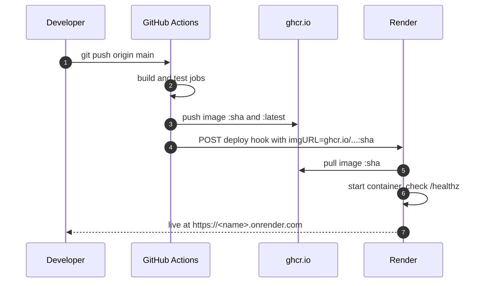

# Render setup

This guide deploys the app to [Render](https://render.com) on every push to `main`. Render runs the same image that CI builds and tests, tagged with the commit SHA. Render does not rebuild it.



## 1. Prerequisites

- A Render account. The free instance type is enough for a demo.
- One successful run of the `artifact-registry` job, so the image `ghcr.io/<owner>/<repo>:latest` exists.
- The ghcr package set to **Public**. Render pulls without credentials. See [step 8 of the Cloud Run guide](cloud-run-setup.md#8-first-deploy). For a private package, add a registry credential in Render instead, under **Settings → Registry Credentials**, using a GitHub PAT with `read:packages`.

## 2. Create the service

1. In the Render dashboard, click **New → Web Service**.
2. Choose **Existing Image**.
3. Set the image URL to `ghcr.io/<owner>/<repo>:latest`, all lowercase.
4. Pick a name, a region and an instance type.
5. Under **Advanced**, set **Health Check Path** to `/healthz`.
6. Click **Deploy Web Service**.

The first deploy uses `:latest`. After that, every deploy from GitHub Actions names an exact `:<sha>` tag.

You don't need to set `PORT`. Render sets it (default `10000`), and `main.go` reads it.

## 3. Connect GitHub Actions

1. In the Render service, open **Settings → Deploy Hook** and copy the URL. It looks like `https://api.render.com/deploy/srv-xxxx?key=yyyy`.
2. In GitHub, go to **Settings → Secrets and variables → Actions → New repository secret**.
   - Name: `RENDER_DEPLOY_HOOK_URL`
   - Value: the hook URL

   With the GitHub CLI:
   ```sh
   gh secret set RENDER_DEPLOY_HOOK_URL --repo <owner>/<repo>
   ```

Treat the hook URL as a password. Anyone with it can trigger deploys. If it leaks, regenerate it in Render and update the secret.

## 4. How the job works

The `deploy-render` job in [`.github/workflows/deploy.yml`](../.github/workflows/deploy.yml) runs after `artifact-registry`, in parallel with the Cloud Run `deploy-cloudrun` job. It runs this command:

```sh
curl -fsS -X POST "$HOOK&imgURL=<url-encoded ghcr.io/owner/repo:sha>"
```

- The `imgURL` parameter tells Render to deploy that exact tag. Each Render deploy then maps to one commit, and the footer version shows the same short SHA.
- If `RENDER_DEPLOY_HOOK_URL` is not set, the job prints a notice and succeeds without deploying. Forks and Cloud Run-only setups therefore keep working.
- `curl -f` makes the job fail if Render rejects the request, for example because the key is wrong.

## 5. Verify

Push a commit, then:

1. Check that the `deploy-render` job prints `Render deploy triggered for ghcr.io/...:<sha>`.
2. In Render, check that the **Events** tab shows a new deploy with that image tag.
3. Open `https://<name>.onrender.com` and check that the footer shows `Version <short sha>`. For this repository, that is https://go-htmx-hackday-26.onrender.com.
4. Run `curl https://<name>.onrender.com/healthz`. It should return `ok`.

To roll back, open **Events** in Render, pick an earlier deploy, and click **Rollback**.

## Render without Cloud Run

`deploy-render` depends only on `artifact-registry`, which publishes to ghcr.io and has no Google Cloud steps. If you never set up Google Cloud, the `deploy-cloudrun` job fails but Render still deploys. To get a green run, delete the `deploy-cloudrun` job from the workflow.

## Troubleshooting

| Symptom | Cause | Fix |
|---------|-------|-----|
| `curl: (22) ... 401` or `404` | Wrong or regenerated hook URL | Copy the hook again and update `RENDER_DEPLOY_HOOK_URL`. |
| Render deploy fails with `unauthorized` or `manifest unknown` | The ghcr package is private, or the tag is not pushed yet | Make the package public, or add a registry credential in Render. |
| Deploy starts but never becomes live | The health check fails | Check that the health check path is `/healthz`, then read the Render logs. The request log lines show each probe. |
| The first request takes 30–60 s | The free instance slept after about 15 minutes idle | Expected on the free tier. Use a paid instance type to keep it awake. |
| The header badge says "Running locally" | The app checks the `RENDER` variable, which Render sets on every service | Check that the deployed image includes this fix: the footer version should be a recent SHA. |
